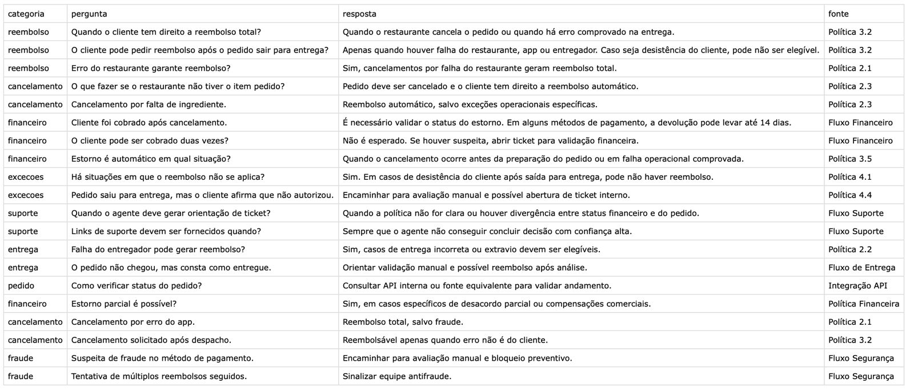
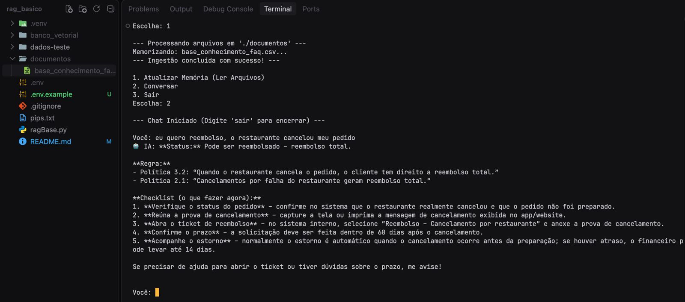

# RAG Básico

Projeto prático de um assistente de perguntas e respostas que combina busca semântica em documentos com geração de texto por um modelo de linguagem. A aplicação usa ChromaDB para armazenar e recuperar documentos e a API da Groq para gerar respostas com base no contexto encontrado.

## Sobre o projeto

O fluxo principal está em `ragBase.py`:

1. Lê arquivos de uma pasta local.
2. Extrai texto de arquivos compatíveis.
3. Salva os documentos no ChromaDB.
4. Busca os documentos mais relevantes para a pergunta.
5. Envia a pergunta e o contexto recuperado para a Groq.

O exemplo de prompt está configurado para responder dúvidas sobre reembolsos. Ajuste as instruções em `gerar_resposta` para adaptar o assistente a outro assunto e use documentos apropriados.

## Tecnologias utilizadas

- Python
- Groq API
- ChromaDB
- pypdf e python-docx para leitura de documentos
- python-dotenv para carregar variáveis de ambiente

## Estrutura do projeto

```text
rag_basico/
+-- README.md
+-- ragBase.py
+-- .env.example
+-- pips.txt
+-- dados-teste/
|   +-- base_conhecimento_ifood_genai-exemplo.csv
+-- imagens/
    +-- base-exemplo.png
    +-- resposta-ia.png
```

Durante a execução, o `ragBase.py` também cria a pasta `documentos/` para os arquivos de entrada e `banco_vetorial/` para persistir os dados do ChromaDB.

## Arquivos

- `ragBase.py`: fluxo principal de ingestão, busca semântica e chat.
- `.env.example`: modelo para configurar a chave da Groq.
- `imagens/`: capturas da base de exemplo e da resposta do assistente.
- `pips.txt`: lista de dependências do projeto.
- `dados-teste/base_conhecimento_ifood_genai-exemplo.csv`: CSV de exemplo. Para indexá-lo, copie-o para `documentos/`, pasta que o programa lê.

## Requisitos

- Python instalado.
- Uma chave de API da Groq.
- Conexão com a internet para consultar a API.

## Como executar

1. Acesse a pasta do projeto:

```bash
cd rag_basico
```

2. Instale as dependências:

```bash
pip install -r pips.txt
```

3. Copie o arquivo `.env.example` para `.env` e substitua o valor pela sua chave da Groq:

```env
GROQ_API_KEY=sua_chave_aqui
```

4. Execute o fluxo RAG:

```bash
python ragBase.py
```

Na primeira execução, escolha `1` para criar a pasta `documentos/`. Coloque nela arquivos `.txt`, `.pdf`, `.docx` ou `.csv` e escolha `1` novamente para indexá-los. Depois escolha `2` para conversar com o assistente; digite `sair` para encerrar o chat.

## Exemplo de uso

A base de exemplo reúne perguntas e respostas sobre reembolsos e cancelamentos:



Após a ingestão da base, o assistente responde a uma pergunta no terminal:



## Observações

- O ChromaDB persiste os dados em `banco_vetorial/`, relativo ao diretório de execução. Ao rodar os comandos acima dentro de `rag_basico`, os arquivos do banco ficam nessa pasta.
- O código consulta até dois documentos por pergunta e envia o conteúdo recuperado à API da Groq.
- A resposta depende do conteúdo indexado e das instruções do prompt; revise a configuração antes de usar com dados ou decisões reais.
- Não compartilhe o arquivo `.env` nem publique sua chave da Groq.

## Aprendizados

Este projeto serve como introdução a conceitos de RAG: ingestão de dados, extração de texto, embeddings e busca vetorial, recuperação de contexto e geração de respostas com um LLM.
